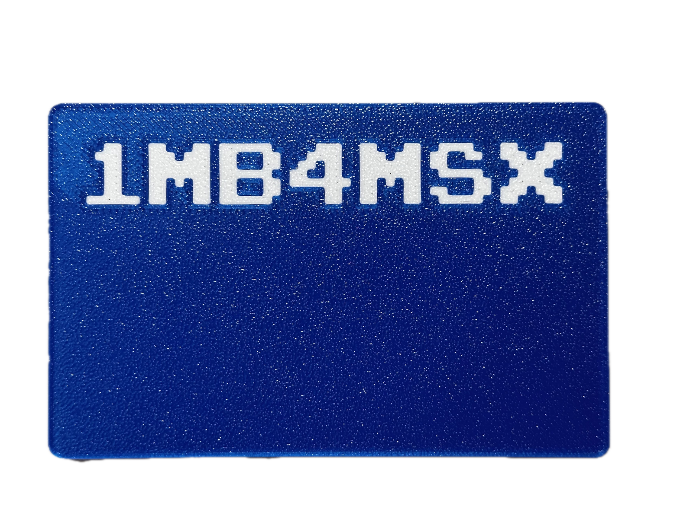

# 1MB4MSX 3D Enclosure

This directory contains the 3D-printable cartridge enclosure files for 1MB4MSX.

## Photos

## File Inventory
- [**`1MB4MSX-case.3mf`**](1MB4MSX-case.3mf): Complete 3D cartridge shell project with dual-color lettering and slicer plate configurations (Bambu Studio / OrcaSlicer / PrusaSlicer).
- [**`1MB4MSX-front.3mf`**](1MB4MSX-front.3mf): Top/front cover shell with embossed "1MB4MSX" text.
- [**`1MB4MSX-bottom.3mf`**](1MB4MSX-bottom.3mf): Bottom shell half with mounting standoffs and cartridge guide rails.

## Recommended Slicer Settings
| Parameter | Setting | Rationale |
| :--- | :--- | :--- |
| **Material** | PLA+, PETG, or ABS/ASA | Good stiffness and clean fit |
| **Layer Height** | 0.16 mm – 0.20 mm | Clean text resolution and slot chamfers |
| **Walls / Perimeters** | 3 – 4 walls | Rigid screw bosses and side rails |
| **Infill** | 20% – 25% | Good structural rigidity |
| **Supports** | None required | Lay flat faces down on build plate |
