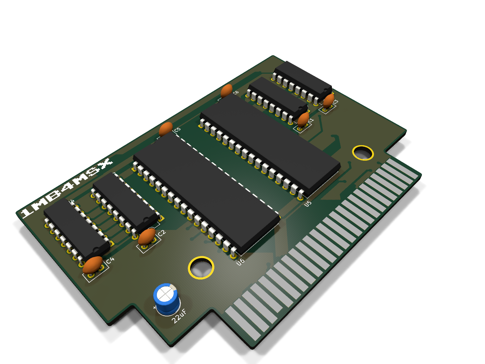
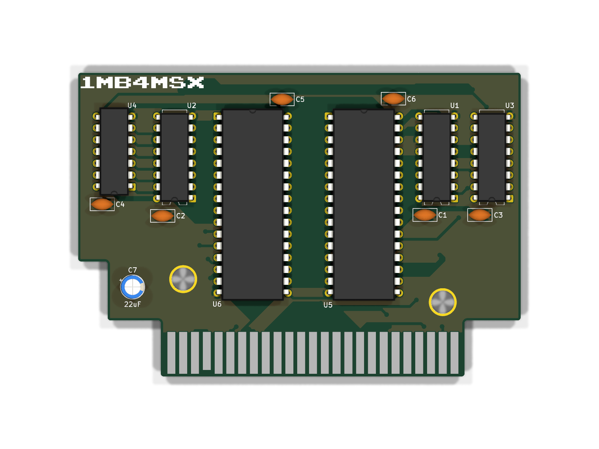
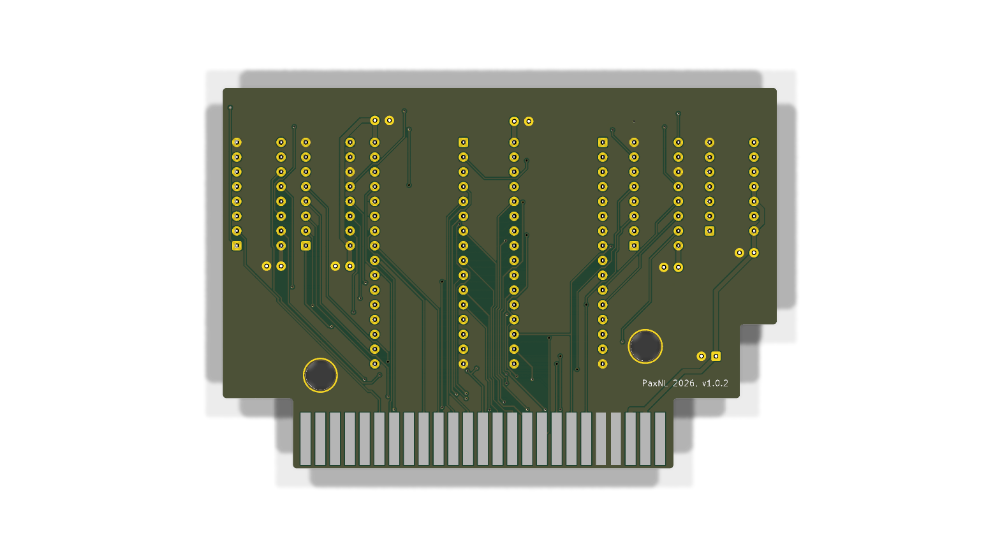

# 1MB4MSX

1 MB (1024 KB) Memory Mapper RAM expansion cartridge for MSX computers.

## Previews

| 3D View | Top | Bottom |
| :---: | :---: | :---: |
|  |  |  |

## Features

- Standard MSX 50-pin cartridge slot form factor (compatible with MSX, MSX2, MSX2+, turboR).
- Provides a full 1024 KB (1 MB) of MSX standard mapped RAM using two AS6C4008 512K low-power SRAM chips.
- Fully compatible with MSX-DOS2, Nextor, Sofarun, MultiMente, and memory-hungry MSX software.
- Standard 74HCT670-based memory mapper architecture with 74LS139 and 74HCT30 glue logic.
- Low power consumption suitable for standard MSX power supplies.
- Custom 3D printable shell included.

## PCB Fabrication

Ready-to-order Gerbers are available in the [gerbers](gerbers/) directory:
- Production package: [1MB4MSX-Gerbers-v1.0.0.zip](gerbers/1MB4MSX-Gerbers-v1.0.0.zip)

Recommended fabrication parameters:
- Layers: 2
- Board thickness: 1.6 mm
- Surface finish: ENIG (recommended for edge connector contact wear resistance)
- Edge connector: 45° bevel / chamfer

## Bill of Materials

An Interactive BOM is hosted online at:
👉 [**Open Interactive BOM (Live PCB Viewer)**](https://msx-hws.github.io/1MB4MSX/bom/ibom.html)

You can also view it locally by opening [bom/ibom.html](bom/ibom.html) in any web browser.

| Ref | Value / Part | Footprint | Notes |
| :--- | :--- | :--- | :--- |
| U1, U2 | 74HCT670 | DIP-16 (300 mil) | 4x4 Register File (mapper registers) |
| U3 | 74LS139 | DIP-16 (300 mil) | Dual 2-to-4 decoder |
| U4 | 74HCT30 | DIP-14 (300 mil) | 8-input NAND gate |
| U5, U6 | AS6C4008-55PCN | DIP-32 (600 mil) | 512K x 8 Low Power SRAM (Total 1024 KB) |
| C1–C6 | 100 nF | 2.5 mm pitch | Ceramic decoupling capacitors |
| C7 | 22 µF | Radial, 2.5 mm pitch | Electrolytic filter capacitor (16V+) |
| J1 | MSX Edge | Card edge | Standard MSX 50-pin slot connector |

Using quality DIP sockets for U1–U6 is recommended.

## 3D Printed Cartridge Shell

Files are located in the [3d-enclosure](3d-enclosure/) directory:
- `1MB4MSX-case.3mf`: Complete 3D cartridge shell project with dual-color lettering and slicer plate configurations.
- `1MB4MSX-front.3mf`: Top/front shell half.
- `1MB4MSX-bottom.3mf`: Bottom shell half with mounting standoffs.

Slicer suggestions:
- Material: PETG or PLA+ (or ABS/ASA)
- Layer height: 0.16–0.20 mm
- Perimeters: 3–4 walls for screw boss rigidity
- Infill: 20–25%

## Usage Notes

1. Insert the cartridge into any free cartridge slot with the MSX powered off.
2. Power on the machine with MSX-DOS2 or Nextor.
3. Test with standard mapper utilities (e.g. `MEMMAN`, `MAPPER.COM`, `RAMTEST.COM`). The cartridge will be detected as a 1024 KB primary memory mapper.

## Repository Contents

```text
1mb4msx/
├── 3d-enclosure/   # Shell 3MF files and photos
├── bom/            # Component list and interactive HTML BOM
├── docs/           # Assembly and verification notes
├── gerbers/        # Production Gerber ZIP, drill files, and PCB photos
├── images/         # PCB render previews and hardware photos
├── LICENSE
└── README.md
```

## Credits

- Design inspired by the open hardware MSX memory mapper community.
- Thanks to the MSX Resource Center community for hardware documentation and testing software.

## License

This project is licensed under the Creative Commons Attribution-NonCommercial-ShareAlike 4.0 International License (CC BY-NC-SA 4.0).

Commercial manufacturing, distribution, or sale of PCBs, assembled cartridges, or enclosure prints is not permitted without prior approval. For commercial licensing inquiries, contact the author.
