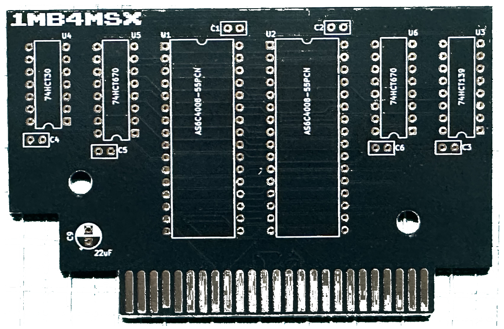
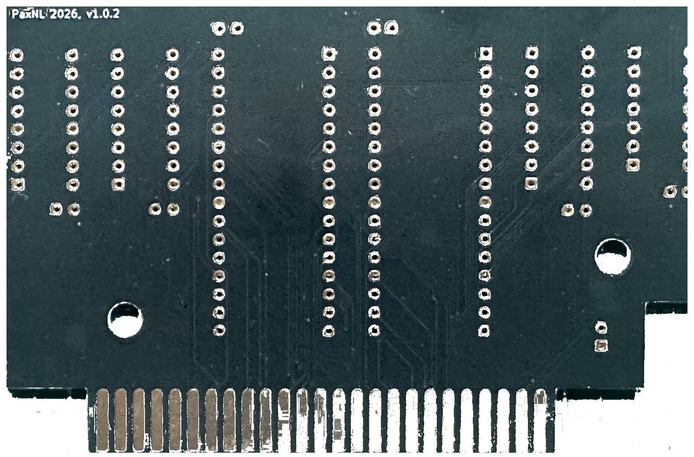

# 1MB4MSX Gerber Production Files

This directory contains the production-ready Gerber and NC drill files for manufacturing the 1MB4MSX PCB.

## Bare PCB Photos

| Component Side (Front) | Solder Side (Back) |
| :---: | :---: |
|  |  |

## Instant Order ZIP Package
- **[`1MB4MSX-Gerbers-v1.0.0.zip`](1MB4MSX-Gerbers-v1.0.0.zip)**: Pre-packaged archive ready for direct upload to PCB manufacturers (JLCPCB, PCBWay, AISLER, etc.).

---

## File Inventory
| Filename | Description | Layer |
| :--- | :--- | :--- |
| `1MB4MSX-F_Cu.gtl` | Front (Top) Copper | Layer 1 |
| `1MB4MSX-B_Cu.gbl` | Back (Bottom) Copper | Layer 2 |
| `1MB4MSX-F_Mask.gts` | Front Solder Mask | Top Mask |
| `1MB4MSX-B_Mask.gbs` | Back Solder Mask | Bottom Mask |
| `1MB4MSX-F_Silkscreen.gto` | Front Silkscreen | Top Legend |
| `1MB4MSX-B_Silkscreen.gbo` | Back Silkscreen | Bottom Legend |
| `1MB4MSX-Edge_Cuts.gm1` | Board Outline & Cutouts | Mechanical Outline |
| `1MB4MSX.drl` | NC Drill File | Plated & Non-Plated Holes |

---

## Recommended PCB Fabrication Options
- **Layers:** 2
- **Thickness:** 1.6 mm (standard MSX slot thickness)
- **Surface Finish:** **ENIG (Immersion Gold)** strongly recommended for cartridge edge connector contact longevity
- **Edge Connector:** **45° Bevel / Chamfer** (essential for smooth insertion into the MSX cartridge slot)
- **Copper Weight:** 1 oz
